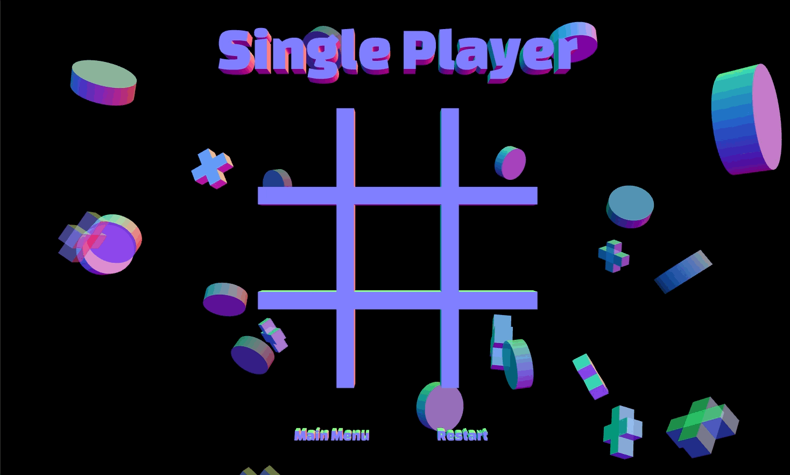

# ❌⭕ Tri-Tac-Toe

Tri-Tac-Toe is an online, 3D Tic-Tac-Toe game I built as a final project for my ICS3U course. It supports multiplayer, single-player, and local game modes.

**Key Technologies:** React, Three.js, Flask, SQLAlchemy, Socket.io, Heroku Postgres

**Key Features:**
* User authentication and accounts with BCrypt.
* Online multiplayer with real-time communication.
* Single-player mode with an unbeatable AI using the minimax algorithm.

The application was originally deployed on Heroku, but it has since been taken down.

## Authentication and User Accounts

Players can create accounts, log in, and log out. User data is stored on a Heroku Postgres database, with passwords hashed using the BCrypt algorithm.

## Game Modes

### Online Multiplayer

Play against another player online. One player generates a unique code, and the other joins using that code. The game runs on Socket.io, enabling real-time communication.

**Steps to start a game:**
1.  **Player 1**: Go to the **Online Game** section and click **Create Game**.
2.  **Player 1**: A unique code is generated.
3.  **Player 2**: Click **Join Game** under the **Online Game** section.
4.  **Player 2**: Enter the code to join Player 1’s game.
5.  The match begins!

### Single Player

Challenge yourself against a computer opponent with three difficulty settings:

| Difficulty | Computer Behavior |
|------------|-----------------------------------------------------------------------------|
| Easy | Makes random moves, offering a simple challenge. |
| Normal | Uses a mix of random moves and the minimax algorithm for balanced gameplay. |
| Hard | Implements the minimax algorithm for an unbeatable challenge. |

### Local Game

Play Tic Tac Toe with a friend on the same device by taking turns on the same computer.

## Special Thanks

I want to thank the following GitHub contributors whose code I referenced to bring this project to life:

-   [Suboptimal Engineer](https://github.com/SuboptimalEng) – 3D Tic-Tac-Toe board design.
-   [Clederson Cruz](https://github.com/Cledersonbc) – Minimax algorithm for single-player mode.
